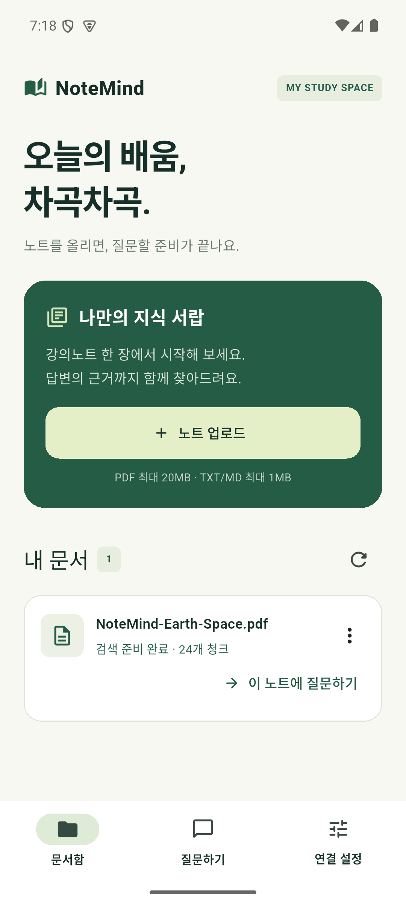
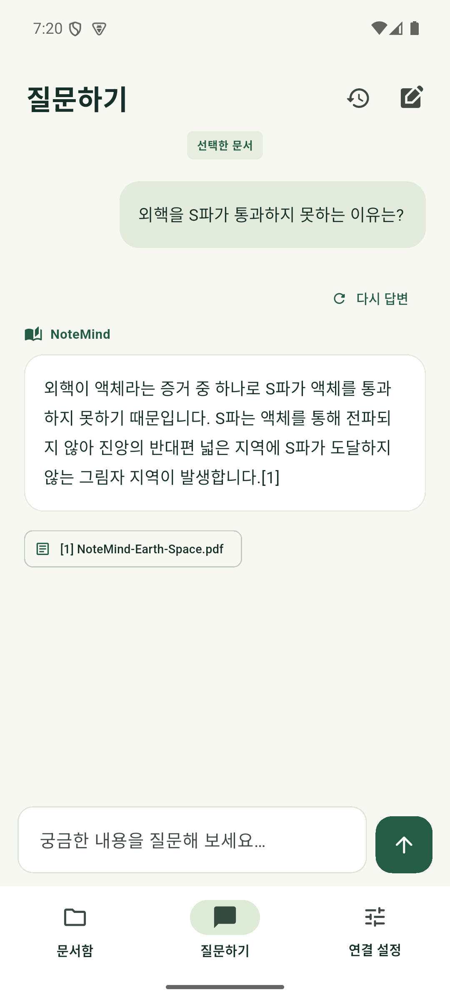
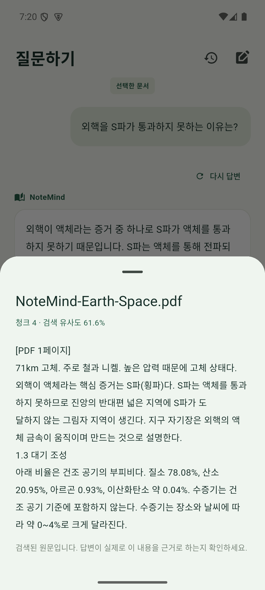
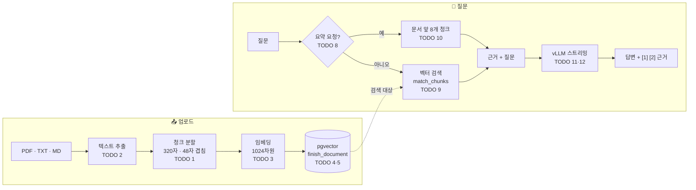
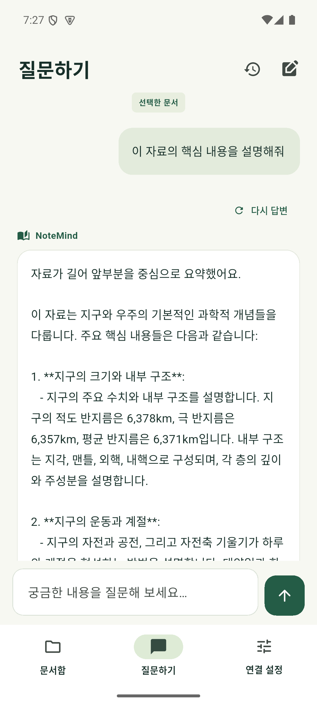
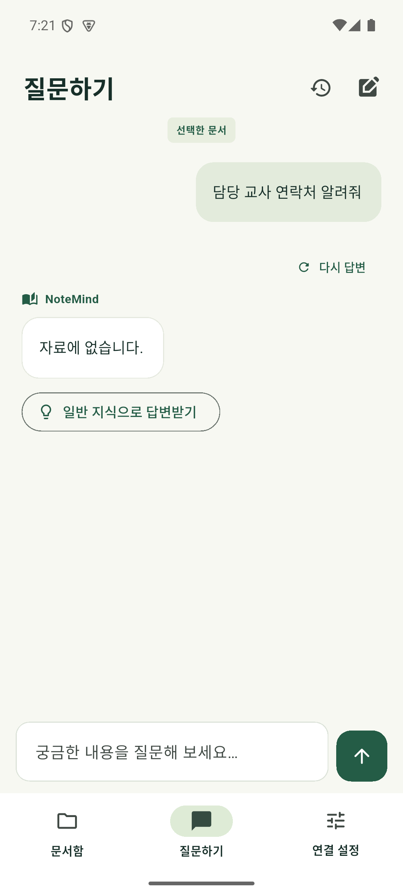

<div align="center">

<a id="top"></a>

# 📚 NoteMind

### 내 PC에서 돌아가는 RAG 노트 앱 — 올린 문서를 근거로만 답합니다

**Flutter** 앱 · **Supabase**(pgvector) · **vLLM** 로컬 LLM으로 만드는 수업 실습 기록

<br>

[](https://flutter.dev)
[](https://dart.dev)
[](https://supabase.com)
[](https://github.com/vllm-project/vllm)
[](https://www.docker.com)
[](#-테스트)
[](./notemind-lab/LICENSE)

[**빠른 시작**](#-빠른-시작) · [**동작 원리**](#-동작-원리) · [**튜토리얼**](#-튜토리얼-todo-112) · [**테스트**](#-테스트) · [**실제 테스트**](#-실제-테스트) · [**문제 해결**](#-문제-해결) · [**수업 기록**](#-수업-기록)

<br>

<table>
  <tr>
    <td align="center"><br><sub><b>① 업로드</b> · 6쪽 PDF → 24개 청크</sub></td>
    <td align="center"><br><sub><b>② 질문</b> · 근거 [1]이 달린 답변</sub></td>
    <td align="center"><br><sub><b>③ 근거 확인</b> · 1페이지 · 유사도 61.6%</sub></td>
  </tr>
</table>

<sub>📱 Android 에뮬레이터에서 실제로 실행한 화면입니다. 더 많은 테스트 화면은 <a href="#-실제-테스트">실제 테스트</a>에서 볼 수 있습니다.</sub>

</div>

<br>

## ✨ 특징

- 🔒 **완전 로컬** — 문서, 벡터, LLM이 모두 내 PC 안에서 돕니다. 외부 API 키가 필요 없습니다.
- 📄 **PDF · TXT · MD 업로드** — 페이지별로 텍스트를 뽑고 `[PDF n페이지]` 출처를 붙여 저장합니다.
- 🔎 **벡터 검색** — 질문과 뜻이 가까운 청크를 pgvector 코사인 유사도로 찾습니다.
- 💬 **스트리밍 답변** — 토큰이 생성되는 대로 화면에 표시하고, 답변마다 `[1] [2]` 근거 카드를 답니다.
- 🧠 **요약 요청 자동 판별** — "요약해줘"는 검색 대신 문서 앞부분으로, "화성의 기온을 요약해줘"는 검색으로 처리합니다.
- 🛡️ **근거 밖 답변 차단** — 자료에 없으면 "자료에 없습니다."로 답하고, 문서 속 명령(프롬프트 인젝션)은 따르지 않습니다.

<br>

## 🚀 빠른 시작

> **준비물**: Windows + NVIDIA GPU(8GB+), Docker Desktop, Flutter 3.47+, Android SDK·JDK·에뮬레이터, Python

```powershell
git clone https://github.com/konga22/lo_AI
cd lo_AI/notemind-lab

# 1. 비밀값 생성 → Supabase 시작 → DB 마이그레이션
python docker/init-env.py
docker compose --project-directory docker/supabase up -d --wait
Get-Content docker/supabase/migrations/001_notemind.sql | docker compose --project-directory docker/supabase exec -T db psql -U postgres -d postgres -v ON_ERROR_STOP=1

# 2. 로컬 LLM 서버 (채팅 8000 → 임베딩 8001 순서로 뜸)
docker compose --project-directory docker/vllm up -d --wait

# 3. 에뮬레이터는 vLLM 다음에, GPU를 쓰지 않는 모드로
& "C:\Android\sdk\emulator\emulator.exe" -avd notemind -gpu swiftshader_indirect
adb reverse tcp:54321 tcp:54321; adb reverse tcp:8000 tcp:8000; adb reverse tcp:8001 tcp:8001

# 4. 앱 실행
cd app-starter; flutter pub get; flutter run
```

앱의 **연결 설정** 탭에 두 키를 넣고 **설정 저장 → 연결 확인**에서 세 줄이 모두 `연결됨`이면 끝입니다.

| 입력란 | 값을 가져올 곳 |
| :-- | :-- |
| Supabase 공개 키 | `docker/supabase/.env` 의 `ANON_KEY` |
| 로컬 추론 API 키 | `docker/vllm/.env` 의 `VLLM_API_KEY` |

> [!IMPORTANT]
> 8GB GPU에서는 **vLLM을 먼저, 에뮬레이터를 나중에** 켜야 합니다. 에뮬레이터가 GPU 메모리를 먼저 잡으면 채팅 모델이 KV 캐시를 확보하지 못합니다. → [문제 해결](#-문제-해결)

<details>
<summary><b>처음이라면: Android Studio 없이 에뮬레이터 만들기</b></summary>

<br>

```powershell
$env:JAVA_HOME = "C:\Program Files\Android\openjdk\jdk-21.0.8"
$sdk = "C:\Program Files (x86)\Android\android-sdk"
& "$sdk\cmdline-tools\latest\bin\sdkmanager.bat" --licenses
& "$sdk\cmdline-tools\latest\bin\sdkmanager.bat" "emulator" "system-images;android-35;google_apis;x86_64"
& "$sdk\cmdline-tools\latest\bin\avdmanager.bat" create avd -n notemind -k "system-images;android-35;google_apis;x86_64" -d pixel_7
```

Flutter는 **공백이 있는 SDK 경로를 지원하지 않습니다.** `Program Files (x86)` 같은 경로라면 공백 없는 별칭(정션)을 만들어 알려 줍니다.

```powershell
cmd /c mklink /J C:\Android\sdk "C:\Program Files (x86)\Android\android-sdk"
flutter config --android-sdk C:\Android\sdk
flutter config --jdk-dir "C:\Program Files\Android\openjdk\jdk-21.0.8"
```

`flutter doctor`의 "Android Studio not installed"는 경고일 뿐 실행에는 영향이 없습니다.

</details>

<p align="right"><a href="#top">⬆ 맨 위로</a></p>

## 🧭 동작 원리



| 구성 요소 | 역할 | 주소 |
| :-- | :-- | :-- |
| **Supabase** (Docker) | 익명 로그인 · PostgreSQL + pgvector · 파일 Storage · RLS | `127.0.0.1:54321` |
| **vLLM 채팅** | 답변 생성 `notemind-chat` | `127.0.0.1:8000` |
| **vLLM 임베딩** | 문장 → 1024차원 벡터 `notemind-embedding` | `127.0.0.1:8001` |
| **Flutter 앱** | 업로드 · 질문 화면 (Android 에뮬레이터) | `adb reverse`로 위 포트 연결 |

<details>
<summary><b>DB 마이그레이션이 만드는 것</b></summary>

<br>

- 테이블 `documents · chunks · conversations · messages` — 청크에 `vector(1024)` 칸
- Storage 버킷 `documents`
- `finish_document(id, chunks)` — 청크를 **한 번에** 저장하고 문서를 `ready`로 → 반쯤 저장된 문서가 검색에 섞이지 않음
- `match_chunks(query_embedding, …)` — `1 - (embedding <=> query)` 코사인 유사도로 가까운 청크 검색
- RLS(행 단위 보안) — 각 사용자는 자기 데이터만 읽고 쓸 수 있음

</details>

<p align="right"><a href="#top">⬆ 맨 위로</a></p>

## 🛠 튜토리얼 (TODO 1~12)

시작 코드는 수업 저장소 [scadasystems/notemind-rag-course](https://github.com/scadasystems/notemind-rag-course)의 `app-starter/`입니다. 화면과 상태 관리는 완성되어 있고 **core 함수 12개가 비어 있습니다**. 이 저장소의 [`notemind-lab/`](./notemind-lab/)에는 12개를 모두 채운 코드가 있습니다.

| # | 함수 | 파일 | 한 줄 요약 | 상태 |
| :-: | :-- | :-- | :-- | :-: |
| 1 | `chunkText` | [`text_processing.dart`](./notemind-lab/app-starter/lib/core/text_processing.dart) | `runes` 단위로 320자씩, 48자 겹쳐 자르기 | ✅ |
| 2 | `extractDocumentChunks` | [`document_import.dart`](./notemind-lab/app-starter/lib/core/document_import.dart) | TXT·MD·PDF 텍스트 추출, `[PDF n페이지]` 표시 | ✅ |
| 3 | `embed` | [`inference.dart`](./notemind-lab/app-starter/lib/data/inference.dart) | `/v1/embeddings` 호출, `index`로 순서 복원 | ✅ |
| 4 | `ingest` | [`repository.dart`](./notemind-lab/app-starter/lib/data/repository.dart) | 기록 → 업로드 → 4개씩 임베딩 → 일괄 저장 | ✅ |
| 5 | `retryDocument` | [`repository.dart`](./notemind-lab/app-starter/lib/data/repository.dart) | 원본을 받아 같은 id로 다시 처리 | ✅ |
| 6 | `createConversation` | [`repository.dart`](./notemind-lab/app-starter/lib/data/repository.dart) | 대화 `insert` | ✅ |
| 7 | `saveMessage` | [`repository.dart`](./notemind-lab/app-starter/lib/data/repository.dart) | 메시지 `upsert` | ✅ |
| 8 | `isDocumentOverviewRequest` | [`text_processing.dart`](./notemind-lab/app-starter/lib/core/text_processing.dart) | 정규식으로 요약 요청 판별 | ✅ |
| 9 | `search` | [`repository.dart`](./notemind-lab/app-starter/lib/data/repository.dart) | `match_chunks` 벡터 검색 | ✅ |
| 10 | `overview` | [`repository.dart`](./notemind-lab/app-starter/lib/data/repository.dart) | 문서 앞 8개 청크 + `partial` | ✅ |
| 11 | `sseData` | [`text_processing.dart`](./notemind-lab/app-starter/lib/core/text_processing.dart) | SSE `data:` 줄 파싱 | ✅ |
| 12 | `chat` | [`inference.dart`](./notemind-lab/app-starter/lib/data/inference.dart) | 스트리밍 답변, `[DONE]` 확인 | ✅ |

> 단계별로 펼쳐 보세요. 각 단계 끝의 명령으로 바로 확인할 수 있습니다.

<details>
<summary><b>Step 1 · 텍스트를 청크로 자르기</b> — TODO 1</summary>

<br>

임베딩 모델이 다루기 좋은 크기(320자)로 자르되, 경계에서 문맥이 끊기지 않게 48자씩 겹칩니다. 문자열이 아니라 **`runes`(유니코드 코드포인트)** 단위로 잘라야 한글·이모지가 깨지지 않습니다.

```dart
final runes = text.replaceAll('\r\n', '\n').replaceAll('\u0000', '').trim().runes.toList();
for (var start = 0; start < runes.length; start += size - overlap) {
  final end = (start + size).clamp(0, runes.length);
  final chunk = String.fromCharCodes(runes.sublist(start, end)).trim();
  if (chunk.isNotEmpty) chunks.add(chunk);
  if (end == runes.length) break; // 끝부분이 중복 청크로 들어가지 않게
}
```

```powershell
flutter test test/core_test.dart --plain-name chunks
```

</details>

<details>
<summary><b>Step 2 · 파일에서 텍스트 뽑기</b> — TODO 2</summary>

<br>

- **TXT·MD** — UTF-8로 읽고 맨 앞 BOM(`\uFEFF`)을 지운 뒤 `chunkText`
- **PDF** — `pdfrx`로 페이지마다 텍스트를 뽑고, 청크 앞에 `[PDF n페이지]`를 붙여 답변에서 출처 페이지를 보여 줄 수 있게 합니다.
- 스캔 PDF(텍스트 0개) → OCR 안내 · 암호 PDF → 암호 안내 · 500페이지 초과 → 거부 · `finally`에서 문서를 반드시 닫음

```dart
for (final page in pages) {
  final text = (await page.loadStructuredText()).fullText;
  chunks.addAll(chunkText(text).map((part) => '[PDF ${page.pageNumber}페이지]\n$part'));
}
```

```powershell
flutter test test/document_import_test.dart
```

</details>

<details>
<summary><b>Step 3 · 임베딩</b> — TODO 3</summary>

<br>

`POST /v1/embeddings`로 문장 목록을 보내 1024차원 벡터를 받습니다. 응답 순서가 섞일 수 있으므로 **`index`로 다시 정렬**하지 않으면 문장과 벡터가 엇갈려 저장됩니다. 차원이 1024가 아니면 DB 칸(`vector(1024)`)에 맞지 않으므로 거부합니다.

```dart
final data = (jsonDecode(response.body)['data'] as List)
    .map((e) => Map<String, dynamic>.from(e)).toList()
  ..sort((a, b) => (a['index'] as int).compareTo(b['index'] as int));
```

```powershell
flutter test test/core_test.dart --plain-name embedding
```

</details>

<details>
<summary><b>Step 4 · 업로드와 색인</b> — TODO 4 · 5</summary>

<br>

1. 청크 만들기 → `documents`에 기록 (새 문서 `insert`, 재시도는 `processing`으로 `update`)
2. Storage에 원본 업로드
3. 청크를 **4개씩** 임베딩하며 진행률 표시
4. `rpc('finish_document')`로 청크를 **한 번에** 저장 → 반쯤 저장된 문서가 검색에 섞이지 않음
5. 실패하면 문서를 `failed`로 표시하고 원래 오류를 다시 던짐 (표시 자체가 실패해도 원래 오류 보존)

재시도(TODO 5)는 Storage에서 원본을 내려받아 같은 id로 `ingest(retry: document)`를 다시 부릅니다.

> ✅ 여기까지 하면 **문서함 → 노트 업로드**가 끝까지 동작하고, 카드에 `검색 준비 완료 · N개 청크`가 뜹니다.

</details>

<details>
<summary><b>Step 5 · 대화와 메시지 저장</b> — TODO 6 · 7</summary>

<br>

대화는 새로 만드는 것이라 `insert`, 메시지는 답변이 스트리밍되는 동안 `generating → complete`로 상태가 바뀔 때마다 **같은 id로 다시 저장**하므로 `upsert`입니다. 대화 제목은 첫 질문을 `runes` 기준 50자까지 씁니다.

</details>

<details>
<summary><b>Step 6 · 요약 요청 판별</b> — TODO 8</summary>

<br>

"요약해줘"처럼 **주제가 없는** 요청은 벡터 검색으로 맞는 근거를 찾을 수 없으므로 문서 앞부분을 근거로 씁니다. "화성의 기온을 요약해줘"처럼 주제가 붙으면 검색해야 합니다. 정규식 `^…$`로 **문장 전체**가 요약 요청 틀과 같은지 봅니다.

```text
^ [이 자료·문서·노트·PDF] [전체·핵심 내용을] (요약|정리) (해줘|해 주세요) $
   앞: 생략 가능            중간: 생략 가능      꼭 있어야 함   끝
```

| 질문 | 결과 |
| :-- | :-: |
| 요약해줘 · 이 문서를 요약해줘 · 핵심 내용을 정리해 주세요. | `true` |
| 화성의 기온을 요약해줘 · 요약하지 말고 지구의 크기를 알려줘 | `false` |

```powershell
flutter test test/core_test.dart --plain-name overview
```

</details>

<details>
<summary><b>Step 7 · 근거 찾기</b> — TODO 9 · 10</summary>

<br>

**검색 (TODO 9)** — 질문 벡터로 DB 함수 `match_chunks`를 호출합니다. RAG의 R(Retrieval)입니다.

```dart
await client.rpc('match_chunks', params: {
  'query_embedding': vector,
  'p_model': model,            // 같은 임베딩 모델로 만든 문서만
  'match_threshold': 0.45,     // 코사인 유사도 0.45 이상
  'match_count': 5,            // 최대 5개
  'p_document_id': documentId, // "이 노트에 질문하기"면 그 문서만
});
```

**요약용 근거 (TODO 10)** — 문서를 하나만 골라 `position` 순으로 9개를 가져와 앞 8개를 씁니다. 9번째가 있으면 문서가 더 길다는 뜻이므로 `partial: true`로 표시합니다.

```powershell
flutter test test/overview_repository_test.dart
```

</details>

<details>
<summary><b>Step 8 · 스트리밍 답변</b> — TODO 11 · 12</summary>

<br>

채팅 서버는 답변을 토큰마다 SSE 형식으로 흘려보냅니다.

```text
data: {"choices":[{"delta":{"content":"안"}}]}

data: {"choices":[{"delta":{"content":"녕"}}]}

data: [DONE]
```

**SSE 파싱 (TODO 11)** — `utf8.decoder`(쪼개진 한글 바이트를 이어 붙임) → `LineSplitter` → `data:` 줄을 모아 **빈 줄마다** 이벤트 하나로 내보냅니다.

**chat (TODO 12)** — `http.Request`를 직접 만들어 `send()`하면 응답이 끝나기 전부터 `response.stream`으로 읽을 수 있습니다.

```dart
..body = jsonEncode({
  'model': config.model,
  'messages': messages,                                // system(규칙 + 근거 [1][2]…) + user
  'stream': true,
  'max_tokens': 768,
  'temperature': 0.2,                                  // 근거에 충실하게
  'chat_template_kwargs': {'enable_thinking': false},  // Qwen3 생각 모드 끄기
});
```

토큰은 받는 대로 `yield`하고, 마지막에 **`[DONE]`을 받았는지 확인**합니다. 받지 못했다면 연결이 중간에 끊긴 것이므로 잘린 답을 정상 답처럼 보여 주지 않도록 오류를 냅니다.

```powershell
flutter test   # 전체 13개
```

</details>

<p align="right"><a href="#top">⬆ 맨 위로</a></p>

## 🧪 테스트

| 종류 | 명령 | 결과 |
| :-- | :-- | :-: |
| 정적 분석 | `flutter analyze` | ✅ 문제 없음 |
| 단위 테스트 | `flutter test` | ✅ 13 / 13 |
| 통합: 업로드 → 재시도 → RAG | `flutter test integration_test/pdf_test.dart -d emulator-5554 …` | ✅ 통과 |
| 통합: 앱 전체 흐름 | `flutter test integration_test/app_test.dart -d emulator-5554 …` | ⚠️ 1개 항목 |

통합 테스트는 키를 `--dart-define`으로 넘깁니다. 실행하면 앱이 다시 설치되므로 테스트 후 연결 설정을 다시 입력하세요.

```powershell
flutter test integration_test/pdf_test.dart -d emulator-5554 `
  --dart-define=SUPABASE_ANON_KEY=<ANON_KEY> `
  --dart-define=INFERENCE_API_KEY=<VLLM_API_KEY>
```

> [!NOTE]
> `app_test`의 ⚠️는 코드 문제가 아닙니다. 답("미래관 402호")은 맞지만 **Qwen2.5-7B**가 `[1]` 인용 지시를 따르지 않았습니다. 수업 기본 모델 **Qwen3-4B-AWQ**(`enable_thinking` 옵션도 Qwen3용)에서는 통과할 가능성이 높습니다.

## 📸 실제 테스트

수업 자료 `NoteMind-Earth-Space.pdf`(지구와 우주 심화 읽기, 6쪽)를 에뮬레이터에서 직접 업로드하고 질문한 결과입니다. 수업 자료는 이 저장소에 포함하지 않았습니다.

| # | 시나리오 | 거치는 TODO | 결과 |
| :-: | :-- | :-: | :-- |
| ① | PDF 업로드 | 1 · 2 · 3 · 4 | ✅ `검색 준비 완료 · 24개 청크` |
| ② | "외핵을 S파가 통과하지 못하는 이유는?" | 3 · 6 · 7 · 9 · 11 · 12 | ✅ 그림자 지역까지 설명하고 `[1]` 인용 |
| ③ | 근거 카드 `[1]` 열기 | 2 · 9 | ✅ `[PDF 1페이지]` 원문 · 검색 유사도 61.6% |
| ④ | "이 자료의 핵심 내용을 설명해줘" | 8 · 10 · 12 | ✅ 검색 없이 앞 8개 청크로 요약 · "자료가 길어 앞부분을 중심으로" 안내 |
| ⑤ | "담당 교사 연락처 알려줘" | 9 · 12 | ✅ 문서에 없으므로 "자료에 없습니다." |

<table>
  <tr>
    <td align="center"><br><sub>① 업로드</sub></td>
    <td align="center"><br><sub>② 벡터 검색 답변</sub></td>
    <td align="center"><br><sub>③ 근거 원문</sub></td>
    <td align="center"><br><sub>④ 요약 요청</sub></td>
    <td align="center"><br><sub>⑤ 근거 없음</sub></td>
  </tr>
</table>

<details>
<summary><b>직접 해 보기</b></summary>

<br>

```powershell
adb push NoteMind-Earth-Space.pdf /sdcard/Download/
```

**문서함 → + 노트 업로드 → Downloads**에서 파일을 고르고, 준비가 끝나면 **이 노트에 질문하기**를 누릅니다. 위 질문 외에 "관측 실습 제출 마감은 언제야?"도 물어보세요. 개정 이력의 옛 날짜에 속지 않고 **11월 18일 18:00**으로 답해야 합니다.

> [!TIP]
> `adb shell input text`로는 한글을 입력할 수 없습니다. 에뮬레이터는 PC 클립보드를 공유하므로, PC에서 질문을 복사한 뒤 입력란을 길게 눌러 **Paste**하면 됩니다.

</details>

<p align="right"><a href="#top">⬆ 맨 위로</a></p>

## 🩺 문제 해결

<details>
<summary><b>vLLM: <code>No available memory for the cache blocks</code></b></summary>

<br>

8GB GPU에서 7B 모델 가중치(약 5.3GiB)를 올리고 나면 KV 캐시 자리가 빠듯합니다. 에뮬레이터(약 600MB) 같은 다른 프로그램이 GPU를 쓰거나 임베딩 서버가 먼저 뜨면 KV 캐시가 음수가 됩니다.

- `docker compose --project-directory docker/vllm up -d --wait`로 **채팅 → 임베딩** 순서로 띄웁니다.
- 에뮬레이터는 vLLM 다음에 `-gpu swiftshader_indirect`로 켭니다.
- `gpu-memory-utilization`을 실제 여유 메모리보다 크게 잡으면 `Free memory on device ... less than desired`가 나므로, 비율을 올리기보다 다른 GPU 사용을 줄입니다.

</details>

<details>
<summary><b>앱: 연결 확인이 <code>HTTP 401</code> 또는 <code>No API key found in request</code></b></summary>

<br>

연결 확인은 **저장된 값이 아니라 입력란의 현재 값**으로 검사합니다. 키 입력란을 비우고 `.env`의 값을 다시 붙여 넣은 뒤 **설정 저장 → 연결 확인**을 누르세요. 통합 테스트를 돌린 뒤에도 앱이 다시 설치되어 키가 지워집니다.

</details>

<details>
<summary><b>Android · Flutter 설정 문제</b></summary>

<br>

| 증상 | 원인 | 해결 |
| :-- | :-- | :-- |
| `sdkmanager`가 아무것도 설치하지 않음 | 라이선스 동의 입력이 전달되지 않음 | `--licenses`로 먼저 동의 |
| `flutter devices`에 에뮬레이터 없음 | SDK 경로에 공백 | `C:\Android\sdk` 정션 + `flutter config --android-sdk` |
| `requires SDK version ^3.13.5` | Flutter의 Dart가 낮음 | `flutter upgrade` |
| 첫 빌드가 매우 느림 | Gradle·NDK(약 2GB) 다운로드 | 첫 빌드만 느림, 이후 약 30초 |
| `adb`를 찾을 수 없음 | `platform-tools`가 PATH에 없음 | `C:\Android\sdk\platform-tools\adb.exe` 전체 경로 사용 |

</details>

<details>
<summary><b>종료하기</b></summary>

<br>

```powershell
docker compose --project-directory docker/vllm down
docker compose --project-directory docker/supabase down   # 데이터는 유지
```

`down -v`는 DB와 업로드 파일이 담긴 볼륨까지 지우므로 일반 종료에 쓰지 않습니다.

</details>

<p align="right"><a href="#top">⬆ 맨 위로</a></p>

## 📁 프로젝트 구조

```text
lo_AI/
├── README.md
├── class-notes-2026-09-10.md        # 1부: Docker · GPU · vLLM · 양자화 · llmfit
├── class-notes-2026-10-15.md        # 2부: NoteMind 수업 상세 기록
├── docs/images/                     # 에뮬레이터 실제 테스트 화면
└── notemind-lab/
    ├── app-starter/                 # Flutter 앱
    │   ├── lib/core/                #   text_processing · document_import · config
    │   ├── lib/data/                #   inference · repository · models
    │   ├── lib/features/            #   screens · controllers (완성 제공)
    │   ├── test/                    #   단위 테스트
    │   └── integration_test/        #   에뮬레이터 통합 테스트
    ├── docker/
    │   ├── init-env.py              # .env 비밀값 생성
    │   ├── supabase/                # compose.yml · migrations/001_notemind.sql
    │   └── vllm/                    # compose.yml · .env.example
    └── start.py                     # 로컬 모델 실행기
```

## 🧱 사용 환경

| 항목 | 버전 · 모델 |
| :-- | :-- |
| GPU | NVIDIA GeForce RTX 4060 (8GB) |
| vLLM | `vllm/vllm-openai:v0.29.0` |
| 채팅 모델 | `Qwen/Qwen2.5-7B-Instruct-GPTQ-Int4` (수업 기본값 `Qwen/Qwen3-4B-AWQ`) |
| 임베딩 모델 | `Qwen/Qwen3-Embedding-0.6B` (1024차원) |
| Flutter / Dart | 3.47.6 / 3.13.5 |
| Android | API 35 x86_64 에뮬레이터 (Pixel 7) |

## 📝 수업 기록

| 날짜 | 내용 |
| :-- | :-- |
| [2026-09-10](./class-notes-2026-09-10.md) | Docker 기초, 컨테이너 GPU 확인, vLLM, 양자화, Hugging Face 토큰, llmfit |
| [2026-10-08 · 10-15](./class-notes-2026-10-15.md) | NoteMind 환경 준비, TODO 1~12, 테스트, 문제 해결 |

## 🔐 보안

- `notemind-lab/docker/**/.env`의 Supabase 키 · DB 비밀번호 · vLLM API 키는 `.gitignore`로 제외됩니다. 각자 `python docker/init-env.py`로 생성하세요.
- 저장소 전체 기록을 [gitleaks](https://github.com/gitleaks/gitleaks)로 검사해 유출이 없음을 확인했습니다.
- Hugging Face 토큰은 비밀번호처럼 다룹니다. 공용 PC에서는 수업 후 토큰을 폐기하고 로그아웃하세요.

## 📄 라이선스 · 감사

- 시작 코드: [scadasystems/notemind-rag-course](https://github.com/scadasystems/notemind-rag-course) — [MIT](./notemind-lab/LICENSE)
- `notemind-lab/docker/supabase/`의 Supabase 구성 파일은 원본 라이선스([LICENSE.upstream](./notemind-lab/docker/supabase/LICENSE.upstream))를 따릅니다.
- [vLLM](https://github.com/vllm-project/vllm) · [Supabase](https://github.com/supabase/supabase) · [pgvector](https://github.com/pgvector/pgvector) · [Qwen](https://github.com/QwenLM) · [pdfrx](https://pub.dev/packages/pdfrx)

<div align="center">
<br>
<sub>로컬 AI 수업 실습 기록 · <a href="#top">⬆ 맨 위로</a></sub>
</div>
